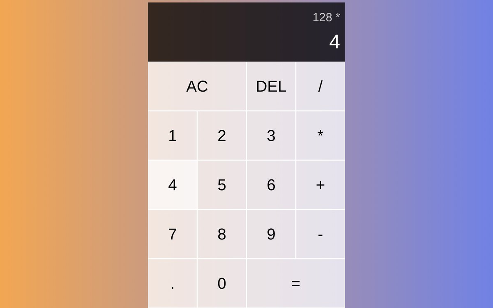

# Calcolatrice

Calcolatrice web con le quattro operazioni, i decimali, il tasto DEL per cancellare l'ultima cifra e AC per azzerare. Mostra l'operazione in corso sopra il risultato e separa le migliaia per rendere i numeri più leggibili.

**Provala online:** [demolitionweb.github.io/Calculator/Index.html](https://demolitionweb.github.io/Calculator/Index.html)

## Tecnologie

- **HTML** per la struttura dei tasti
- **CSS Grid** per la tastiera e un gradiente per lo sfondo
- **JavaScript** con una classe `Calculator` che gestisce numeri, operazioni e display

## Cosa ho imparato

- organizzare la logica in una classe con metodi separati (`appendNumber`, `chooseOperation`, `compute`, `updateDisplay`)
- collegare i pulsanti alla logica con `addEventListener`
- formattare i numeri con `toLocaleString`

## Provarla in locale

Scarica il repository e apri `Index.html` nel browser.
